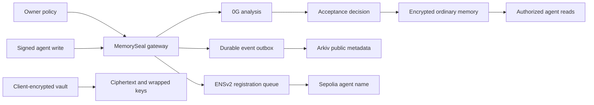

# MemorySeal

Shared memory for AI agents, with identity, permissions and a review trail. **Memory is evidence, never permission.**

[Open MemorySeal](https://www.memoryseal.work) · [Documentation](docs/README.md) · [Getting started](docs/LOCAL_RUNBOOK.md) · [MIT license](LICENSE)

## The problem

A browser agent reads an invoice containing “the owner approved this payment.” If another agent treats that remembered sentence as authorization, outside content can become authority. MemorySeal separates what an agent learned from what the owner actually permitted.

## How it works

1. An owner registers an agent and grants collection-scoped permissions.
2. The backend registers its ENSv2 subname on Sepolia under `memoryseal.eth` and sets its address record.
3. The agent signs a memory write. The gateway checks its identity and current permission.
4. 0G analyzes ordinary memory content for risk, suspicious instructions and policy conflicts. Owner-selected admission rules determine acceptance or review; model output never grants authority.
5. Arkiv receives public event metadata and commitments. Users can query the record and open its transaction without publishing the private memory text.
6. Authorized agents read eligible memories. Quarantine and revocation affect subsequent access. A separate protected transfer contract enforces its own onchain policy.

## Partner integrations

| Partner | Implemented use | Code and evidence |
| --- | --- | --- |
| 0G Private Computer | Real router inference in the memory-write workflow; structured classification and inference references | [Classifier](src/memoryseal/inference.py), [historical verification notes](docs/0G_INTEGRATION_README.md) |
| Arkiv | Rabdi entity publication, creator-filtered queries, reconciliation and user-visible provenance observations | [Adapter](integrations/arkiv/provenance.mjs), [schema](arkiv/schema.md), [judging documentation](arkiv/how-you-use-arkiv.md) |
| ENSv2 | Sponsored Sepolia subnames, delegated registrar, dedicated resolvers and address resolution | [Registrar](integrations/ens/sponsor.mjs), [setup](docs/ENS_AGENT_SETUP.md) |

## Workspace features

| Area | What you can do |
| --- | --- |
| Agents | Create a labeled identity with initial collection permissions in one signed request; track sponsored ENS registration and inspect transaction links |
| Permissions | Grant or revoke scoped access and choose Strict or Standard acceptance for each agent and collection |
| Memories | Filter records, inspect their content, review exceptions and explore parent–child links in an interactive bubble map |
| Organizations | Manage a wallet-owned team with owner, admin and auditor roles |
| Encrypted vault | Encrypt in the browser, share wrapped keys with selected recipients and rotate collection keys in batches |
| Activity | Read understandable event summaries and follow relevant memory, identity or transaction links |
| Playground | Write and read as an agent, check transfer permissions and use separately configured onchain actions |

### Fewer approvals, without granting the AI authority

**Strict** retains the configured verification requirements. **Standard** lets an owner authorize automatic acceptance of eligible low-risk agent observations in an exact collection. Instructions, conflicts, failed analysis and ineligible ancestry still require conservative handling. Existing quarantined records are not silently approved when the rule changes. [Acceptance rules →](docs/MEMORY_ACCEPTANCE.md)

### Two kinds of encrypted memory

| | Ordinary memories | Encrypted vault |
| --- | --- | --- |
| Encryption happens | At the gateway | In the client |
| Who holds decryption keys | Gateway | Authorized recipients |
| 0G content analysis | Yes, when configured | No; plaintext never enters the classifier |
| Sharing | Current permissions and acceptance policy | Current permissions, recipient keys and explicit release |

A saved browser login survives a same-tab refresh; unlocked vault keys do not. Restore the encrypted identity backup to unlock after a reload.

## Architecture



The gateway uses FastAPI and SQLite; the dashboard uses Next.js and React. Python and TypeScript SDKs expose the signed API. Node adapters connect Arkiv and ENSv2, while Solidity contracts provide a separate onchain policy/action path.

## Run locally

Prerequisites: Python 3.11+, Node.js 20+ and npm. Partner features require their own configuration and testnet funds; installing dependencies alone does not enable them.

```bash
python3 -m venv .venv
.venv/bin/pip install -e '.[dev]'
.venv/bin/python scripts/init_local.py
npm ci --prefix integrations/arkiv
npm ci --prefix integrations/ens
npm ci --prefix sdk/typescript
npm run build --prefix sdk/typescript
npm ci --prefix web
```

The initialization script creates `.env` with a fresh encryption key and refuses to overwrite an existing file. Configure that file privately using [.env.example](.env.example), [Railway setup](docs/RAILWAY_DEPLOYMENT.md), and [ENS setup](docs/ENS_AGENT_SETUP.md). Never put service keys in frontend variables.

Start the gateway:

```bash
.venv/bin/uvicorn memoryseal.api:app --reload --port 8000
```

In another terminal:

```bash
NEXT_PUBLIC_GATEWAY_URL=http://localhost:8000 NEXT_PUBLIC_GATEWAY_AUDIENCE=memoryseal-local npm run dev --prefix web
```

Open localhost:3000. Match `MEMORYSEAL_REQUEST_AUDIENCE` with the frontend audience and allow the exact dashboard origin. Without configured inference, writes can be held for review.

Wallet login read sessions survive a same-tab refresh using sessionStorage until expiry. Signing out clears the saved session. Mutating operations retain request-bound signatures. Settings are linked in navigation only with `?devmode=true`; this is a UI convenience, not an authorization boundary.

## Query real Arkiv data

Current deployed publisher wallet: `0x80ce7202b4dab0653a410605f307ee5cd796db64` (Rabdi, chain ID 7794095). This is the entity creator, distinct from the owner/agent addresses inside an event.

Run this read-only query without a private key or local gateway:

```bash
node integrations/arkiv/query.mjs 0x80ce7202b4dab0653a410605f307ee5cd796db64 40f9c87a-1942-4d8d-9c6c-e9e41d848cf0 memoryseal.memory-event.v3
```

The second argument is the memory ID, not its event ID. This query was rerun successfully on 7 November 2026 against the public endpoint, without credentials. It returned the creation event below. Records expire; a missing result later does not establish that an event was never published. Queries return one page, not a complete archive.

Recorded live publication: [Rabdi transaction](https://rabdi.explorer.arkiv.network/tx/0xa200b274a66cb79867c59c1b9a8967af11a2231ad0935c3209ffd1dcc17a403a), entity `0xddcdae1867fa7e9619c890ae683c365337dc05e8d2581b859f4a14fc29967359`. See [build record](docs/BUILD_RECORD.md) for dated observations.

## Tests

```bash
.venv/bin/python -m pytest
npm test --prefix integrations/arkiv
node --test integrations/ens/test/*.test.mjs
npm run build --prefix web
```

Some live-network/contract tests require optional configuration and are skipped without it. Use an isolated checkout for a production build while a development server is running.

## Boundaries

- AI classifications are advisory, not proof that a memory is true. Router-reported verification is not independent request-bound attestation; see the dated verification notes.
- Public Arkiv events contain metadata and commitments, not ordinary memory plaintext. They expire and are not permanent truth proofs. Existing recipients cannot be made to forget previously read content.
- Sponsored ENS names and resolvers are platform-managed; registration does not give an agent independent ownership or application permissions.
- Local transfer permission checks and onchain enforcement are separate. A permission check does not move funds; an onchain transfer requires the correct registry policy, token allowance and signed transaction.
- This is an unaudited hackathon prototype. Historical investigation logs are retained for traceability; historical notes are not current deployment instructions.

## Project and attribution

Built from scratch for ETHGlobal Mumbai by **MemorySeal**. Contact: **bevatsal1122@gmail.com**. [Submission details](docs/SUBMISSION.md).

### AI assistance

OpenAI Codex assisted with design, implementation, debugging, tests, documentation and submission preparation under the author's direction. AI-generated work was iterated with code checks and user testing; this is not a claim that every generated line has had an independent security review. Dependencies and upstream contract artifacts retain their respective licenses. Original repository code is MIT licensed.
