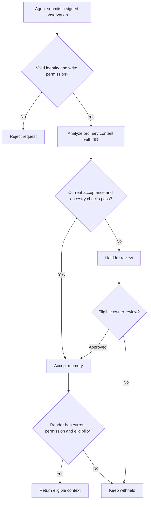

# MemorySeal, explained

MemorySeal is a shared notebook for AI agents, with named authors, access rules and a history you can inspect. One agent can remember information for another without turning that information into permission to act.

For example, a research agent might read “this invoice has been approved.” That statement is something it found, not proof that the owner approved a payment. MemorySeal keeps those two ideas separate.

## The main pieces

| Piece | In everyday terms | Why it exists |
| --- | --- | --- |
| Owner | Person responsible for the workspace | Decides who can participate and what they may do |
| Agent | Software with a signing identity | Makes attributable requests and uses only its granted access |
| Collection | A named folder, called a namespace in the API | Separates research, support, finance or other contexts |
| Memory | A saved observation with author, status and lineage | Carries context between agents |
| Permission | A separate rule | Controls reads, writes and configured actions |
| Review | An owner decision about sharing | Handles exceptions without rewriting what originally happened |

## 1. Sign in

Connect a wallet and sign the readable login message. This proves control of the address and starts a short-lived session; it is not a token transfer.

The session lasts 30 minutes and survives refreshes in the same tab without extending its expiry. Signing out or changing account/network clears it. Routine reads reuse the session; changes such as granting access or writing memory still need request-bound signatures.

The header shows the current address with refresh, Switch account and Sign out. A wallet is an identity here, not a requirement to pay for every click.

## 2. Create an agent

In Agents, choose a friendly label, enter the agent's public signing address and select a collection and initial permissions. One signed setup request creates the agent and its selected access together. It does not create or run the agent's AI software, and the public address is not its private key.

The backend also queues its sponsored ENS registration when configured. A name such as `research-48271.memoryseal.eth` gives the identity a readable label that resolves to the signing address. Five random digits help avoid collisions; existing registered names remain unchanged.

A four-stage indicator shows registration, resolver creation, attachment and address verification. The backend pays Sepolia gas from a dedicated registrar. After completion, the card shows the ready name and expandable transaction links. These are real testnet records, managed by the platform.

## 3. Choose permissions and acceptance

A research agent might have read and write access to `research`, while a finance agent has read access there and different permissions elsewhere. Collection names must match exactly. An ENS name or an AI recommendation does not grant access.

There are two ordinary-memory acceptance modes:

| Mode | Behavior |
| --- | --- |
| Strict | Uses the deployment's verification requirements and conservative admission rules |
| Standard | Owner authorizes eligible low-risk agent observations to pass automatically in one collection |

Standard requires structured analysis describing a low-risk observation, an accept recommendation, no suspicious instruction and no reported conflict. Failed analysis, failed verification and ineligible parent history do not qualify. Unverified analysis remains labeled unverified; automatic acceptance does not make it verified or true.

The owner sets this rule once for an agent and collection. Existing held memories are not automatically released. This removes repeated approvals for eligible observations while retaining review for exceptions.

## 4. Write a memory

Connect the agent wallet and open Playground. Select the relevant collection, enter the observation and choose Save memory. Confirm the wallet signature.

The gateway checks the signed request and permission, calls 0G for ordinary-memory analysis, applies the current admission rules and stores the record encrypted. A successful save clears the editor. If the response is lost, the application retains the exact request so a retry can recover its outcome without inventing a new request ID.

This diagram describes ordinary memories. The encrypted vault follows a separate path because its plaintext is hidden from the gateway and classifier.

## 5. Inspect and connect memories

Memories offers filters, compact records and a bubble map. A child can reference the earlier memory it depends on. Arrows show those explicit parent references; the graph does not invent relationships based on similar wording.

Select a bubble to inspect it and highlight nearby links. Pan and zoom to explore. A dashed parent is outside the loaded page or filters; Find parent performs a scoped lookup. Bubble size represents visible connections, not reliability.

Inspection checks a content commitment: a fingerprint derived from the content and a private random salt. This helps detect a mismatch with the saved content. It does not prove that the original statement was accurate.

## 6. Review exceptions

A held memory stays stored for inspection but is not automatically available to agents. The owner can review eligible records or quarantine a previously accepted one. Current read checks also consider permissions, revocation, policy and ancestry.

For example, if a summary depends on a withheld source memory, it should not become a way to bypass that source's restriction. Revocation affects future access; it cannot erase text an agent already received.

## 7. Understand Arkiv receipts

Saving or reviewing a memory can create a public lifecycle event. A durable outbox records that publication work beside the local change. The background worker sends metadata to Arkiv, while the actual memory text stays private.

| State | Meaning |
| --- | --- |
| Pending | Waiting for publication |
| Publishing | A submission attempt is in progress |
| Uncertain | The outcome needs reconciliation; do not assume failure or send another copy blindly |
| Published | A record has been identified as published |
| Matched observation | A current query returned matching expected metadata |

View transaction opens the explorer. A record check performs a read and compares data; it does not create a transaction. Reconciliation searches for an uncertain submission without blindly republishing it.

Arkiv records use a 30-day default expiry. Public metadata is independently queryable but is not permanent proof of truth or a complete history. The creator is the platform publisher; the agent address in the event identifies the contributing application identity.

## 8. Work with a team

Organizations adds owner, admin and auditor roles. The owner manages membership. Admins manage supported agent and permission tasks; auditors inspect metadata. Membership changes use version checks so an old screen cannot silently overwrite a newer change.

A team is not a multisig wallet. An admin role does not let someone sign the owner's token approval or reveal vault plaintext without the required encryption keys.

## 9. Keep content private from the gateway

Use Encrypted vault when the gateway should store ciphertext rather than see the note. Generate an encryption identity, save its encrypted backup and register only the public key. Restore that backup when unlocking again after a reload.

Each collection has a data key wrapped separately for its authorized recipients. Verify recipient fingerprints through a trusted channel before sharing. Possessing a wrapped key is like receiving a locked envelope; only the matching private identity can open it.

Vault content is not analyzed by 0G. Sharing depends on permissions, recipient keys and explicit release. This gives stronger confidentiality from the storage server at the cost of server-side content analysis and more key-management responsibility.

## 10. Rotate vault keys

Remove unwanted access, generate a fresh collection key and wrap it for the intended recipients. New writes use that key version. The client migrates older records in signed batches of up to five, preserving their content commitments and checking revisions.

Progress can resume after interruption. Keep the old identity until existing data is migrated and recovery is tested. Rotation protects future access; it cannot take back previously downloaded keys or plaintext.

## 11. Follow activity and onchain actions

Activity translates events into readable summaries with relevant links to records, identities and transactions. Expanded details preserve technical evidence without making every record a wall of JSON.

A local transfer permission check answers whether local policy allows an amount. An actual protected transfer separately requires the selected network's contract policy, token allowance and signed transaction. The registry and executor enforce their own state; changing a local memory never changes a contract permission.

## Why these tools?

| Tool | Role | Alternative and tradeoff | If omitted |
| --- | --- | --- | --- |
| 0G | Structured analysis of ordinary memory | Another model could classify, but would change the compute integration and its trust assumptions | This implementation loses AI-assisted admission analysis; permissions still work |
| ENSv2 | Readable onchain agent names and delegated registration | A database nickname is simpler but is not externally resolvable ENS identity | Agents can still sign with addresses but lose this naming layer |
| Arkiv | Public, creator-filtered provenance records | A private database is simpler but independent readers need our API or database access | Local history remains, but the independent public read path disappears |
| SQLite + FastAPI | Transactional state and signed API enforcement | A server database could suit larger deployments but requires migration work | The current gateway loses its authoritative application state |
| Next.js + React | Wallet-driven workspace and interactive views | A CLI could call the same API but would be less approachable | SDK clients still work without the dashboard |
| Client Web Crypto | Vault encryption and key wrapping | Gateway-only encryption is easier but gives the gateway decryption access | Vault confidentiality from the gateway is lost |
| Solidity policy contracts | Separate enforcement for configured onchain actions | Backend checks alone require trusting the backend for execution | The independent contract enforcement path is absent |
| Python/TypeScript SDKs | Reusable signing, retry and encryption helpers | Direct HTTP calls are possible but must implement the protocol correctly | Each integration must recreate those checks |

## What MemorySeal promises—and what it does not

MemorySeal separates remembered information from authority, makes current access explicit and exposes an inspectable history. It does not prove all AI output correct, make public records permanent, retract downloaded data or turn a name into permission. The gateway, client, keys and configured external services each have their own trust assumptions.

Use [local setup](LOCAL_RUNBOOK.md) to build a workspace, [acceptance rules](MEMORY_ACCEPTANCE.md) for precise admission behavior and [the documentation index](README.md) for integration details.
